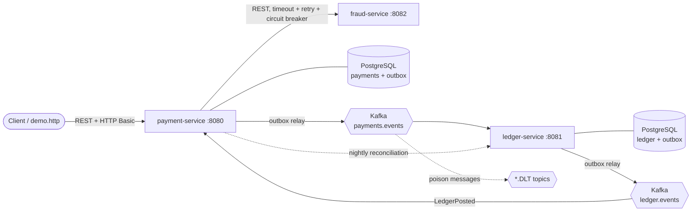

# PayFlow

An event-driven payments system in Java 21 and Spring Boot 4. A personal project for learning how banks move money safely: no duplicate charges, no money booked twice, two-person approval for risky payments, a double-entry ledger, and a nightly check that everything agrees.

Everything runs locally in Docker with free tools.

## Architecture



1. A **maker** creates a payment. payment-service checks the `Idempotency-Key`, asks **fraud-service** for a verdict, and routes the payment: approve, hold for a checker, or fail.
2. The payment row and a `PaymentApproved` event are written in **one database transaction** (transactional outbox). A relay then publishes the event to Kafka.
3. **ledger-service** books it as a balanced **debit and credit**, skipping events it has already processed, and publishes `LedgerPosted` the same way.
4. payment-service marks the payment **SETTLED**.
5. Every night, **reconciliation** compares settled payments with ledger postings and records any mismatch.

## What it does

| Area | Feature | How |
|---|---|---|
| Correctness | No double charges on retry | `Idempotency-Key` header per user. The app checks first, and a `UNIQUE (created_by, idempotency_key)` constraint catches simultaneous retries. A test fires 20 at once and gets exactly 1 payment. |
| | Key reuse detection | Same key with a different body returns `422` (SHA-256 request fingerprint) |
| | Money handled exactly | `BigDecimal` / `NUMERIC(19,2)`, never `double` |
| | Strict payment lifecycle | `CREATED → APPROVED → SETTLED`, `CREATED → PENDING_APPROVAL → APPROVED`, any non-final → `FAILED`. Illegal moves return `409`. |
| Messaging | No lost or phantom events | Transactional outbox in both services, published with `FOR UPDATE SKIP LOCKED` |
| | No double booking | Ledger records every processed event ID (`INSERT … ON CONFLICT DO NOTHING`) plus `UNIQUE (payment_id)` on postings |
| | Poison messages don't block | 3 retries with backoff, then a `.DLT` dead-letter topic. Bad JSON skips the retries. |
| Ledger | Double-entry bookkeeping | Each posting is one DEBIT and one CREDIT. A **deferred constraint trigger** refuses to commit an unbalanced posting. |
| | Append-only history | Triggers block `UPDATE`, `DELETE` and `TRUNCATE` on ledger tables |
| Security | Roles | `MAKER` creates, `CHECKER` approves/rejects, `AUDITOR` reads and reconciles. Unknown endpoints are denied by default. |
| | Maker-checker (four-eyes) | The creator can't approve their own payment, enforced in code **and** by a DB `CHECK` constraint |
| Resilience | Fraud check can fail safely | Connect/read timeouts, retry with exponential backoff, and a Resilience4j circuit breaker. If the check is unavailable, the payment is **held for a human**, never approved blindly. |
| Operations | Nightly reconciliation | Finds payments missing from the ledger, amount mismatches, unbooked settlements, unknown and unbalanced postings |
| | Metrics | Micrometer → `/actuator/prometheus`; optional Prometheus + Grafana dashboard |
| Delivery | CI | GitHub Actions runs every service's tests (real PostgreSQL + Kafka via Testcontainers) and builds the Docker images |

## Run it (all free)

You need **Docker** (Docker Desktop or Rancher Desktop). For running from source you also need **JDK 21**.

**Everything in Docker, one command:**

```bash
docker compose --profile apps up -d --build
```

Then open [demo.http](demo.http) in VS Code with the REST Client extension and click through the walkthrough. Add `--profile observability` for Prometheus (`:9090`) and Grafana (`:3000`, dashboard "PayFlow overview").

**Or infrastructure in Docker, services from source:**

```bash
docker compose up -d                                   # PostgreSQL x2 (host ports 15432, 15433) + Kafka
./mvnw -pl fraud-service spring-boot:run               # Windows: .\mvnw.cmd ...
./mvnw -pl ledger-service spring-boot:run
./mvnw -pl payment-service spring-boot:run
```

Demo users (local only): `maker1`, `maker2` (MAKER), `checker1` (CHECKER), `lead1` (MAKER + CHECKER), `auditor1` (AUDITOR). The password is the username + `-pass`, for example `maker1-pass`.

```bash
curl -i -u maker1:maker1-pass -X POST 127.0.0.1:8080/api/payments \
  -H "Content-Type: application/json" -H "Idempotency-Key: demo-1" \
  -d '{"debtorAccount":"ACC10001","creditorAccount":"ACC20002","amount":150.00,"currency":"USD"}'
```

## API

| Service | Endpoint | Who |
|---|---|---|
| payment | `POST /api/payments` (header `Idempotency-Key`) | MAKER |
| payment | `GET /api/payments/{id}`, `GET /api/payments?status=` | MAKER, CHECKER, AUDITOR |
| payment | `POST /api/payments/{id}/approve`, `POST /api/payments/{id}/reject` `{reason}` | CHECKER (not the creator) |
| payment | `POST /api/reconciliation/runs?from=&to=`, `GET /api/reconciliation/runs` | AUDITOR |
| ledger | `GET /api/ledger/postings/{paymentId}`, `GET /api/ledger/postings?from=&to=` | internal |
| ledger | `GET /api/ledger/accounts/{account}/balances`, `GET /api/ledger/trial-balance` | internal |
| fraud | `POST /api/fraud-checks`, `PUT /api/chaos` `{failureRate, delayMs}` | internal |

Errors are RFC 9457 problem-detail JSON.

## Tests

```bash
./mvnw verify            # all services
```

70 tests, all run on every push by GitHub Actions. Integration tests start **real PostgreSQL 17 and Kafka 4.2 in Docker** (Testcontainers); external HTTP services are replaced by small stub servers so failures can be staged.

| Service | Tests | Highlights |
|---|---|---|
| payment-service | 52 | 20 simultaneous same-key requests create exactly 1 payment; roles and four-eyes rule; retries, timeout and circuit breaker against a failing fraud stub; outbox publishing; settlement from Kafka; duplicate and poison events; every reconciliation mismatch type |
| ledger-service | 13 | Balanced debit/credit per payment; duplicate deliveries booked once; dead-letter topic; database refuses an unbalanced posting; ledger rows can't be updated or deleted |
| fraud-service | 5 | Allow / review / deny rules, validation, chaos mode |

Measured locally (laptop, Docker with 8 CPUs, 10 concurrent curl clients, 200 payments): p50 120 ms and p95 194 ms per create; all 200 booked in the ledger about 1.3 s after the last request.

## Project layout

```
payflow/
  payment-service/   REST API, idempotency, fraud check client, maker-checker, outbox, reconciliation
  ledger-service/    Kafka consumer, double-entry ledger, outbox, read API
  fraud-service/     rule-based fraud check with a chaos switch for demos
  observability/     Prometheus scrape config, Grafana data source + dashboard
  Dockerfile         one multi-stage build for all services
  docker-compose.yml infrastructure + optional "apps" and "observability" profiles
  demo.http          click-through demo
  AI_NOTES.md        how AI tools were used, and the design decisions
```

## Known limits (deliberate, for a portfolio project)

- Demo users live in memory with HTTP Basic. Production would use OAuth2/JWT from an identity provider such as Keycloak.
- ledger-service and fraud-service APIs are unauthenticated "internal" APIs. Production would use mTLS or service tokens.
- Single Kafka broker and single database instances. No replication.
- The outbox relay polls every 500 ms. Change-data-capture (Debezium) would cut latency at the cost of more infrastructure.
- Account balances may go negative: overdraft and funds-availability rules are out of scope.

See [AI_NOTES.md](AI_NOTES.md) for how AI tools were used on this project.
